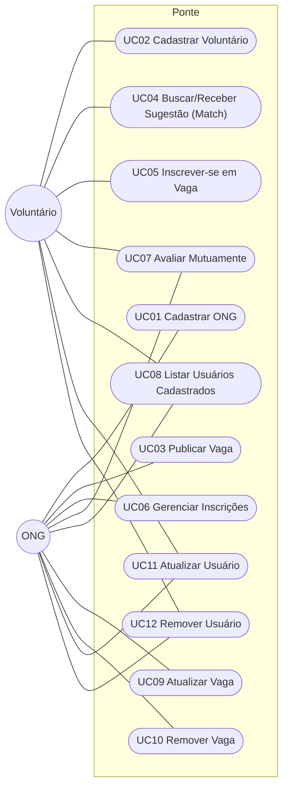

# Casos de uso

> Diagrama com **todos** os casos de uso do sistema e descrição detalhada de cada um. UC01, UC02, UC08 (Sprint 1/2, Gerenciamento de Usuários) e UC09–UC12 (Sprint 3, CRUD de Vaga e de Usuário) estão implementados — os demais são especificados para orientar o desenvolvimento das próximas sprints (ver [`docs/00-entregas.md`](../00-entregas.md)).

## Diagrama de casos de uso

> UC08 é um ID novo, atribuído agora para "Listar Usuários Cadastrados" (já implementada, mas sem ID formal até esta migração). A partir daqui, IDs de caso de uso não são renumerados nem reaproveitados.

## Índice e rastreabilidade

| Caso de uso | Ator principal | Requisitos | Status | Descrição detalhada |
|---|---|---|---|---|
| UC01 Cadastrar ONG | ONG | RF01, NF-USA-01, NF-SEG-01 | Implementado (Sprint 1) | [UC01](UC01-cadastrar-ong.md) |
| UC02 Cadastrar Voluntário | Voluntário | RF02, NF-USA-02, NF-SEG-01 | Implementado (Sprint 1) | [UC02](UC02-cadastrar-voluntario.md) |
| UC03 Publicar Vaga | ONG | RF03, NF-USA-01 | Não implementado | [UC03](UC03-publicar-vaga.md) |
| UC04 Buscar/Receber Sugestão (Match) | Voluntário | RF04, NF-USA-02, NF-DES-01 | Não implementado | [UC04](UC04-buscar-match.md) |
| UC05 Inscrever-se em Vaga | Voluntário | RF05, NF-USA-02, NF-CON-01 | Não implementado | [UC05](UC05-inscrever-se-em-vaga.md) |
| UC06 Gerenciar Inscrições | ONG | RF06, RF08, NF-USA-01, NF-CON-01 | Não implementado | [UC06](UC06-gerenciar-inscricoes.md) |
| UC07 Avaliar Mutuamente | ONG, Voluntário | RF07, RF09, RF10, NF-SEG-01, NF-CON-01 | Não implementado | [UC07](UC07-avaliar-mutuamente.md) |
| UC08 Listar Usuários Cadastrados | ONG, Voluntário | — | Implementado (Sprint 1) | [`docs/specs/gerenciamento-usuarios.md`](../specs/gerenciamento-usuarios.md) |
| UC09 Atualizar Vaga | ONG | RF11 | Implementado (Sprint 3) | [UC09](UC09-atualizar-vaga.md) |
| UC10 Remover Vaga | ONG | RF12 | Implementado (Sprint 3) | [UC10](UC10-remover-vaga.md) |
| UC11 Atualizar Usuário | ONG, Voluntário | RF13 | Implementado (Sprint 3) | [UC11](UC11-atualizar-usuario.md) |
| UC12 Remover Usuário | ONG, Voluntário | RF14 | Implementado (Sprint 3) | [UC12](UC12-remover-usuario.md) |

Imagem original (anexo, só UC01/UC02/UC08): [`docs/specs/anexos/diagrama-casos-de-uso-gerenciamento-usuarios.png`](../specs/anexos/diagrama-casos-de-uso-gerenciamento-usuarios.png).
