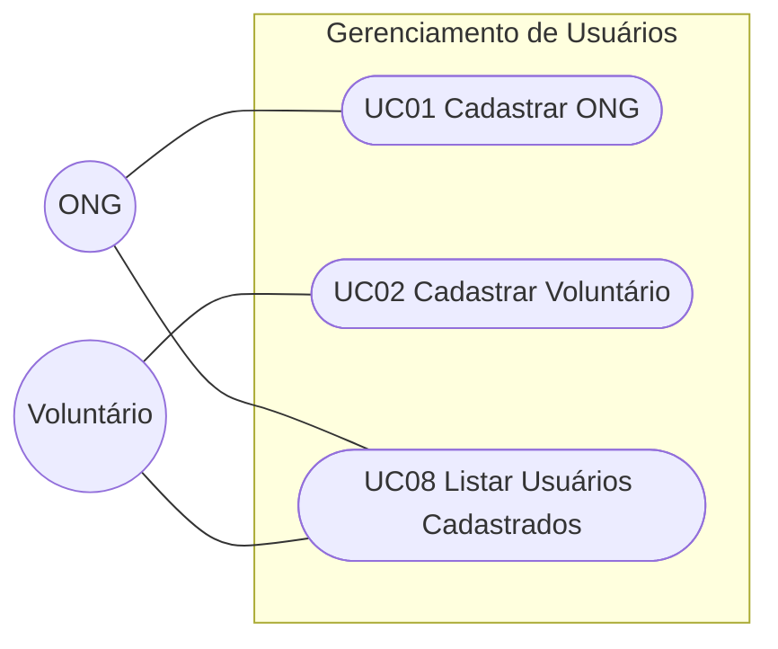

# Casos de uso

> Diagrama com os casos de uso do módulo de **Gerenciamento de Usuários** (já implementado). O diagrama com **todos** os casos de uso do sistema (UC01–UC10) e a descrição detalhada dos 3 mais importantes são itens da Entrega 2 (30/10/2026, ver `00-entregas.md` do modelo da disciplina) — as descrições completas das 7 histórias já elicitadas estão, por ora, em [`docs/specs/casos-de-uso.md`](../specs/casos-de-uso.md).

## Diagrama de casos de uso — Gerenciamento de Usuários

> UC08 é um ID novo, atribuído agora para "Listar Usuários Cadastrados" (já implementada, mas sem ID formal até esta migração). A partir daqui, IDs de caso de uso não são renumerados nem reaproveitados.

## Índice e rastreabilidade

| Caso de uso | Ator principal | Requisitos | Descrição detalhada |
|---|---|---|---|
| UC01 Cadastrar ONG | ONG | RF01 | [`docs/specs/casos-de-uso.md`](../specs/casos-de-uso.md#uc01-cadastrar-ong) |
| UC02 Cadastrar Voluntário | Voluntário | RF02 | [`docs/specs/casos-de-uso.md`](../specs/casos-de-uso.md#uc02-cadastrar-voluntário) |
| UC08 Listar Usuários Cadastrados | ONG, Voluntário | — | [`docs/specs/gerenciamento-usuarios.md`](../specs/gerenciamento-usuarios.md) |

Imagem original (anexo): [`docs/specs/anexos/diagrama-casos-de-uso-gerenciamento-usuarios.png`](../specs/anexos/diagrama-casos-de-uso-gerenciamento-usuarios.png).
