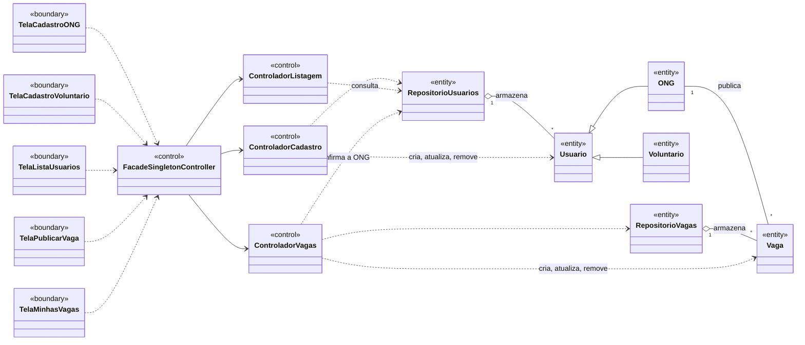

# Análise de casos de uso — diagrama de classes de análise

> As classes aparecem **sem atributos e métodos**, mas com os relacionamentos já definidos. Os estereótipos são os do ICONIX: «boundary» (fronteira), «control» (controle) e «entity» (entidade). Os nomes das entidades vêm do [glossário](02-glossario.md).
> Escopo até a Sprint 3: [Gerenciamento de Usuários](04-casos-de-uso/README.md) (UC01, UC02, UC08, UC11, UC12) e CRUD de **Vaga** (UC03, UC09, UC10). Tudo passa pela fachada única `FacadeSingletonController` (Facade + Singleton).

As fronteiras são as telas [TL01–TL03](06-interface/README.md), que ainda não têm implementação web. No código, a fronteira atual é a CLI `src/fronteira/cli.ts`, que só conversa com a `FacadeSingletonController`. As telas nunca chamam um controlador específico diretamente: a fachada é o único ponto de entrada (ver [ADR-0002](07-arquitetura/adr/0002-facade-singleton-controller.md)). O diagrama de classes de **projeto**, com atributos, assinaturas de método e as classes de erro, está em [`08-projeto.md`](08-projeto.md).

## Rastreabilidade: caso de uso → classes

| Caso de uso | Controle (via fachada) | Entidades | Fronteira |
|---|---|---|---|
| UC01 — Cadastrar ONG | ControladorCadastro | ONG, RepositorioUsuarios | TelaCadastroONG (TL01) |
| UC02 — Cadastrar Voluntário | ControladorCadastro | Voluntario, RepositorioUsuarios | TelaCadastroVoluntario |
| UC08 — Listar Usuários Cadastrados | ControladorListagem | Usuario, RepositorioUsuarios | TelaListaUsuarios |
| UC11 — Atualizar Usuário | ControladorCadastro | ONG / Voluntario, RepositorioUsuarios | TelaCadastroONG / TelaCadastroVoluntario (modo edição) |
| UC12 — Remover Usuário | ControladorCadastro | Usuario, RepositorioUsuarios | TelaListaUsuarios |
| UC03 — Publicar Vaga | ControladorVagas | Vaga, ONG, RepositorioVagas, RepositorioUsuarios | TelaPublicarVaga (TL02) |
| UC09 — Atualizar Vaga | ControladorVagas | Vaga, RepositorioVagas | TelaMinhasVagas (TL03) → TelaPublicarVaga (TL02) |
| UC10 — Remover Vaga | ControladorVagas | Vaga, RepositorioVagas | TelaMinhasVagas (TL03) |
