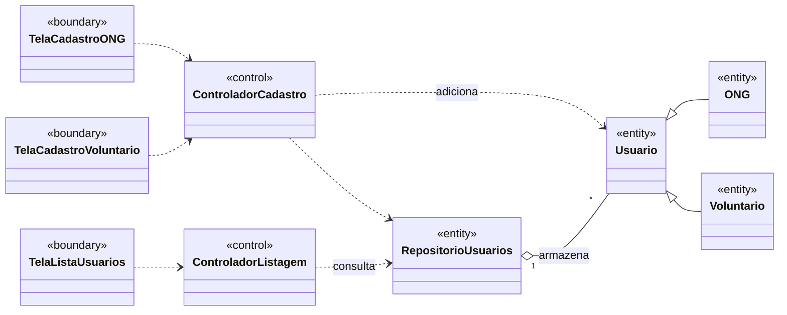

# Análise de casos de uso — diagrama de classes de análise

> Classes **sem atributos e métodos**, mas com os relacionamentos já definidos. Estereótipos ICONIX: «boundary» (fronteira), «control» (controle), «entity» (entidade). Os nomes das entidades vêm do [glossário](02-glossario.md). Escopo: módulo de [Gerenciamento de Usuários](04-casos-de-uso/README.md) (UC01, UC02, UC08).

As telas `TelaCadastroONG`, `TelaCadastroVoluntario` e `TelaListaUsuarios` ainda não foram implementadas — dependem da stack de interface a ser definida (ver [`01-visao.md`](01-visao.md) §2.5). O diagrama de classes de **projeto**, com atributos, assinaturas de método e as classes de erro adicionadas no Laboratório 2, está em [`08-projeto.md`](08-projeto.md).

## Rastreabilidade caso de uso → classes de controle

| Caso de uso | Controle | Fronteiras |
|---|---|---|
| UC01 — Cadastrar ONG | ControladorCadastro | TelaCadastroONG |
| UC02 — Cadastrar Voluntário | ControladorCadastro | TelaCadastroVoluntario |
| UC08 — Listar Usuários Cadastrados | ControladorListagem | TelaListaUsuarios |
