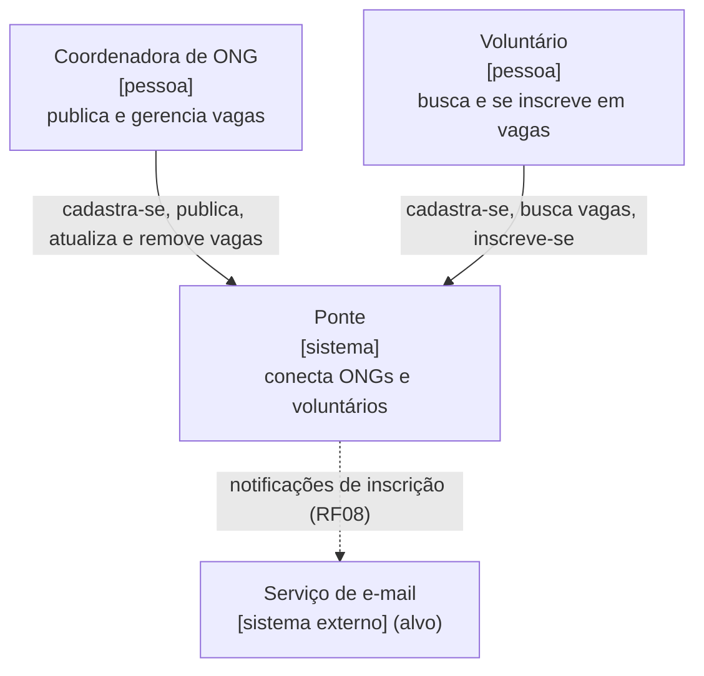
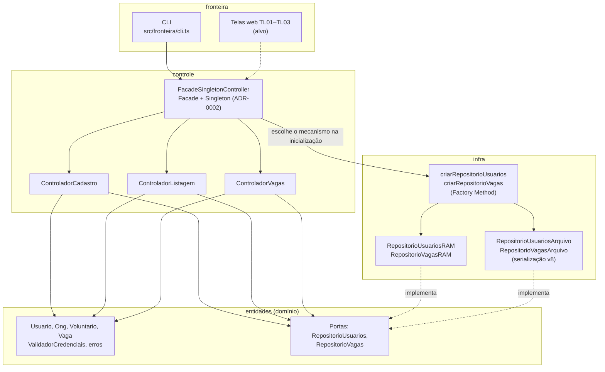
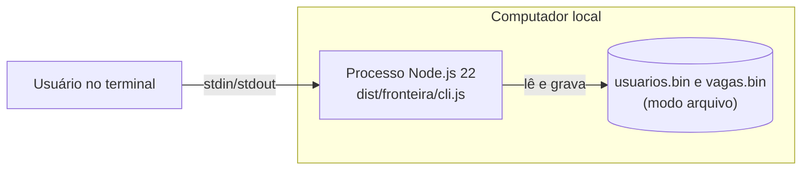
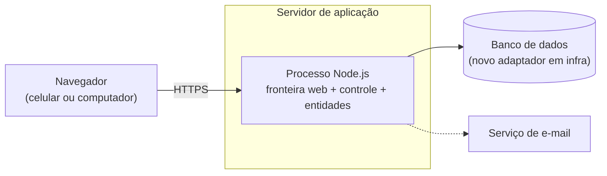

# Arquitetura

> Seção 9 do modelo. Contém os diagramas de arquitetura **lógica** e **física** e explica **como cada requisito não funcional é atendido**. Os diagramas seguem o estilo [C4](https://c4model.com/), e as decisões importantes estão registradas como ADRs em [`adr/`](adr/).
> Cada diagrama separa o que **já existe** no código (Sprint 3) do que é **alvo** (planejado). As partes que ainda não existem aparecem tracejadas ou marcadas como *(alvo)*.

## 9.1 Contexto (C4 nível 1)

## 9.2 Arquitetura lógica: camadas (C4 nível 2/3)

Monolito em camadas, conforme o ICONIX (fronteira, controle, entidade) e o NF-MAN-01. As dependências sempre apontam para dentro: a fronteira só conhece a fachada, os controles só conhecem o domínio, e a infraestrutura implementa as **portas** (interfaces) que o domínio define ([ADR-0001](adr/0001-persistencia-substituivel.md)).

| Camada | Responsabilidade | Pode depender de |
|---|---|---|
| `fronteira` | Conversar com o usuário: ler entrada e mostrar resultado e erros | `controle`, só pela fachada |
| `controle` | Orquestrar os casos de uso e expor uma API única (fachada) | `entidades` |
| `entidades` | Regras de negócio, validações, exceções e portas de persistência | nenhuma camada |
| `infra` | Adaptadores das portas (RAM e arquivo) e a fábrica que escolhe entre eles | `entidades` |

## 9.3 Arquitetura física: implantação

### Atual (Sprint 3)

Um único processo Node.js na máquina do usuário. Usuários e vagas ficam em memória ou em arquivos binários locais, conforme a escolha feita ao iniciar a CLI.

### Alvo (após a definição da stack de interface)

Para trocar o arquivo binário pelo banco basta escrever um novo adaptador em `infra/` e uma nova opção na fábrica. Controles e domínio não mudam (NF-MAN-01).

## 9.4 Como cada requisito não funcional é atendido

| RNF | Decisão / tática arquitetural | Onde | Situação |
|---|---|---|---|
| NF-MAN-01 — Camadas e persistência substituível | Os controles dependem das interfaces `RepositorioUsuarios`/`RepositorioVagas`, e a fábrica escolhe a implementação (RAM ou arquivo) no início da execução | `entidades/` (portas), `infra/fabricaRepositorios.ts`, [ADR-0001](adr/0001-persistencia-substituivel.md) | Atendido (usuários e vagas); banco de dados no alvo |
| NF-CON-02 — Falhas de armazenamento tratadas | Todo erro de E/S é capturado no adaptador e convertido em `ErroDeArquivo` (subclasse de `ErroDePersistencia`) com a causa original. A CLI mostra só a mensagem | `infra/RepositorioUsuariosArquivo.ts`, `fronteira/cli.ts` | Atendido |
| NF-SEG-02 — Senha nunca exibida | A listagem passa por `omitirSenha()` antes de sair do controle, e a fachada devolve `Omit<Usuario, 'senha'>`. Nenhuma tela tem campo de senha legível | `controle/ControladorListagem.ts`, `entidades/Usuario.ts`, TL01 | Atendido |
| NF-USA-01 — Publicar vaga em ≤ 2 min | Formulário de publicação só com os 4 campos obrigatórios. O publicador vem da sessão, não é digitado. A validação acontece no controle e devolve mensagens sem jargão | TL02, `validarCampos` em `controle/ControladorVagas.ts` | Regras atendidas; teste com usuárias pendente (depende da tela web) |
| NF-USA-02 — Responsivo 320–1920 px | Layout de uma coluna abaixo de 600 px e alvos de toque ≥ 44 px, já previstos nos wireframes | [`06-interface`](../06-interface/README.md), contêiner web | Planejado |
| NF-SEG-01 — LGPD | Consentimento opt-in no cadastro (TL01) e remoção de conta (UC12), que já apaga o registro do repositório. Exportação de dados e registro da finalidade ficam na camada de controle | TL01, `ControladorCadastro.removerUsuario` | Parcial: remoção implementada; consentimento e exportação planejados |
| NF-DES-01 — Lista/Match em ≤ 3 s | Busca feita no repositório, que no alvo será um banco com índice por data e habilidade, em vez de filtrar a lista inteira na memória | `infra/` (adaptador de banco, alvo) | Planejado (Match ainda não implementado) |
| NF-CON-01 — Integridade de inscrição/avaliação | Regras de limite de vagas e de liberação da avaliação ficam no domínio, nunca na fronteira, para valerem em qualquer interface | `entidades/` (alvo) | Planejado (inscrições ainda não implementadas) |

## Decisões registradas (ADRs)

- [ADR-0001 — Persistência substituível](adr/0001-persistencia-substituivel.md)
- [ADR-0002 — Fachada única com Facade + Singleton](adr/0002-facade-singleton-controller.md)
