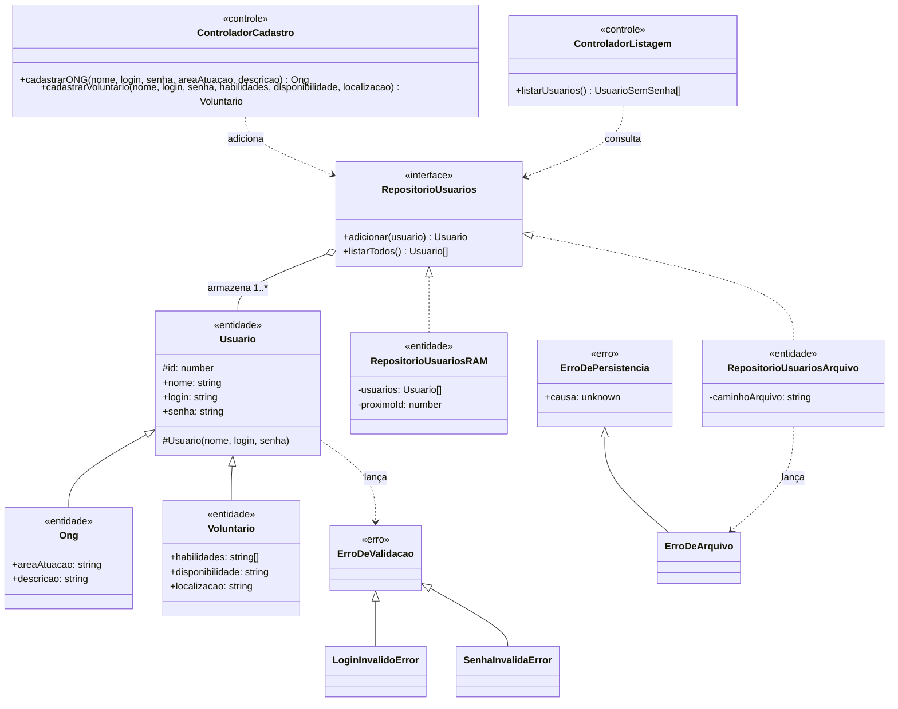

# Projeto detalhado — pacotes, classes de projeto e padrões

> Diferente do diagrama de **análise** ([`05-analise.md`](05-analise.md)), que é conceitual e muda pouco, este diagrama tem atributos e assinaturas de método, e evolui a cada sprint.

## 1. Divisão de pacotes

```text
src/
├── entidades/          ← modelos de domínio e persistência (RAM e arquivo binário)
│   ├── erros/           ← ErroDeValidacao, ErroDePersistencia e subclasses
│   └── validacao/        ← ValidadorCredenciais (login, senha)
└── controle/            ← orquestram casos de uso, chamando as entidades
```

A camada `fronteira` (telas/API) será adicionada quando a stack de interface for definida (ver [`01-visao.md`](01-visao.md) §2.5).

**Regra de dependência:** `controle` depende de `entidades`; `entidades` não depende de `controle`.

## 2. Diagrama de classes de projeto

### Estado atual: Sprints 1 e 2 (Gerenciamento de Usuários + Laboratório 2)



Uma função `criarRepositorioUsuarios(tipo, caminhoArquivo?)` (não é uma classe, por isso fora do diagrama) seleciona a implementação de `RepositorioUsuarios` no início da execução — ver [ADR-0001](07-arquitetura/adr/0001-persistencia-substituivel.md).

## 3. Padrões de projeto utilizados

Preencha uma linha por padrão aplicado. Cada padrão relevante também tem um ADR.

| Padrão | Sprint | Classes participantes (papel no padrão) | Problema que resolve no projeto | ADR |
|---|---|---|---|---|
| Factory Method | S2 | `criarRepositorioUsuarios` (fábrica) → `RepositorioUsuariosRAM` / `RepositorioUsuariosArquivo` | Escolher a implementação de persistência sem acoplar os controladores a uma classe concreta | [ADR-0001](07-arquitetura/adr/0001-persistencia-substituivel.md) |
| Singleton | S3 | | | |
| Facade | S3 | | | |
| Repository | S4 | | | |
| Adapter | S4 | | | |
| Template Method | S4 | | | |
| Command | S5 | | | |
| Memento | S5 | | | |
