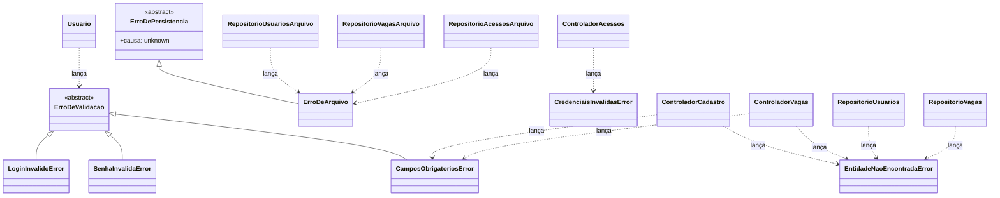

# Projeto detalhado — pacotes, classes de projeto e padrões

> Diferente do diagrama de **análise** ([`05-analise.md`](05-analise.md)), que é conceitual e muda pouco, este diagrama tem atributos e assinaturas de método, e evolui a cada sprint.

## 1. Divisão de pacotes

```text
src/
├── entidades/          ← business: domínio, regras e as PORTAS (interfaces) de persistência e de log
│   ├── erros/           ← ErroDeValidacao, ErroDePersistencia, CredenciaisInvalidasError…
│   └── validacao/        ← ValidadorCredenciais (login, senha)
├── controle/            ← business: orquestram casos de uso, chamando as entidades
│   └── relatorios/       ← Template Method do relatório de acessos (HTML, CSV)
├── infra/              ← adaptadores das portas: repositórios RAM/arquivo, fábricas, log (pino)
└── fronteira/          ← interface com o usuário: hoje uma CLI (`cli.ts`), que só usa a fachada
```

`entidades` e `controle` formam a camada **business**; `infra` é a camada de **infraestrutura**. A CLI é o ponto de entrada (`npm start`). Ela escolhe o mecanismo de persistência no início da execução e cria a fachada com `FacadeSingletonController.inicializar(tipo)`. As telas web ([TL01–TL03](06-interface/README.md)) vão entrar na mesma camada quando a stack de interface for definida (ver [`01-visao.md`](01-visao.md) §2.5).

**Regra de dependência:** `fronteira` depende só de `controle`, por meio da fachada. `controle` e `infra` dependem de `entidades`, e `entidades` não depende de ninguém. Os adaptadores de `infra` implementam as interfaces (portas) definidas no domínio — inversão de dependência (ver [ADR-0001](07-arquitetura/adr/0001-persistencia-substituivel.md)). A única dependência de `controle` para `infra` é a fachada escolher, na inicialização, a fábrica de repositórios e o registrador de log.

## 2. Diagrama de classes de projeto

### Estado atual: Sprints 1 a 4 (usuários, vagas, fachada, acessos e relatórios)

O diagrama separa a camada **business** (entidades e controle) da camada **infra** em todas as entidades. Para não poluir, as exceções aparecem no diagrama seguinte.

```mermaid
classDiagram
    namespace business_entidades {
        class Usuario {
            <<abstract>>
            +id: number
            +nome: string
            +login: string
            +senha: string
            #Usuario(nome, login, senha)
        }
        class Ong {
            +areaAtuacao: string
            +descricao: string
        }
        class Voluntario {
            +habilidades: string[]
            +disponibilidade: string
            +localizacao: string
        }
        class Vaga {
            +id: number
            +ongId: number
            +data: string
            +local: string
            +quantidadeVagas: number
            +habilidadesExigidas: string[]
        }
        class Acesso {
            +id: number
            +usuarioId: number
            +dataHora: Date
        }
        class RepositorioUsuarios {
            <<interface>>
            +adicionar(usuario) Usuario
            +buscarPorId(id) Usuario
            +listarTodos() Usuario[]
            +atualizar(usuario) Usuario
            +remover(id) void
        }
        class RepositorioVagas {
            <<interface>>
            +adicionar(vaga) Vaga
            +buscarPorId(id) Vaga
            +listarTodas() Vaga[]
            +atualizar(vaga) Vaga
            +remover(id) void
        }
        class RepositorioAcessos {
            <<interface>>
            +adicionar(acesso) Acesso
            +listarTodos() Acesso[]
        }
        class FabricaRepositorios {
            <<interface>>
            +criarRepositorioUsuarios() RepositorioUsuarios
            +criarRepositorioVagas() RepositorioVagas
            +criarRepositorioAcessos() RepositorioAcessos
        }
        class Registrador {
            <<interface>>
            +registrar(nivel, mensagem, contexto) void
        }
    }

    namespace business_controle {
        class FacadeSingletonController {
            -instancia: FacadeSingletonController$
            +inicializar(tipoPersistencia, registrador)$ FacadeSingletonController
            +obterInstancia()$ FacadeSingletonController
            +contarEntidadesCadastradas() number
            +entrar(login, senha) UsuarioSemSenha
            +gerarRelatorioAcessos(formato) string
        }
        class ControladorCadastro {
            +cadastrarONG(nome, login, senha, areaAtuacao, descricao) Ong
            +cadastrarVoluntario(nome, login, senha, habilidades, disponibilidade, localizacao) Voluntario
            +atualizarONG(id, ...) Ong
            +atualizarVoluntario(id, ...) Voluntario
            +removerUsuario(id) void
        }
        class ControladorListagem {
            +listarUsuarios() UsuarioSemSenha[]
        }
        class ControladorVagas {
            +publicarVaga(ongId, data, local, quantidadeVagas, habilidadesExigidas) Vaga
            +buscarVaga(id) Vaga
            +listarVagas() Vaga[]
            +atualizarVaga(id, dados) Vaga
            +removerVaga(id) void
        }
        class ControladorAcessos {
            -agora: Relogio
            +entrar(login, senha) UsuarioSemSenha
            +gerarRelatorio(formato) string
        }
        class RelatorioAcessos {
            <<abstract>>
            +gerar(usuarios, acessos, geradoEm) string
            -calcularEstatisticas(usuarios, acessos) EstatisticaUsuario[]
            #cabecalho(geradoEm)* string
            #linha(estatistica)* string
            #rodape(totalAcessos, totalUsuarios)* string
        }
        class RelatorioAcessosHTML
        class RelatorioAcessosCSV
    }

    namespace infra {
        class RepositorioUsuariosRAM
        class RepositorioUsuariosArquivo {
            -caminhoArquivo: string
        }
        class RepositorioVagasRAM
        class RepositorioVagasArquivo {
            -caminhoArquivo: string
        }
        class RepositorioAcessosRAM
        class RepositorioAcessosArquivo {
            -caminhoArquivo: string
        }
        class FabricaRepositoriosRAM
        class FabricaRepositoriosArquivo {
            -caminhos: CaminhosArquivos
        }
        class AdaptadorRegistradorPino {
            -logger: Logger
            +registrar(nivel, mensagem, contexto) void
        }
    }

    class Cli {
        <<fronteira>>
    }

    Usuario <|-- Ong
    Usuario <|-- Voluntario
    Vaga --> Ong : ongId
    Acesso --> Usuario : usuarioId

    RepositorioUsuarios <|.. RepositorioUsuariosRAM
    RepositorioUsuarios <|.. RepositorioUsuariosArquivo
    RepositorioVagas <|.. RepositorioVagasRAM
    RepositorioVagas <|.. RepositorioVagasArquivo
    RepositorioAcessos <|.. RepositorioAcessosRAM
    RepositorioAcessos <|.. RepositorioAcessosArquivo
    FabricaRepositorios <|.. FabricaRepositoriosRAM
    FabricaRepositorios <|.. FabricaRepositoriosArquivo
    FabricaRepositoriosRAM ..> RepositorioUsuariosRAM : cria
    FabricaRepositoriosRAM ..> RepositorioVagasRAM : cria
    FabricaRepositoriosRAM ..> RepositorioAcessosRAM : cria
    FabricaRepositoriosArquivo ..> RepositorioUsuariosArquivo : cria
    FabricaRepositoriosArquivo ..> RepositorioVagasArquivo : cria
    FabricaRepositoriosArquivo ..> RepositorioAcessosArquivo : cria
    Registrador <|.. AdaptadorRegistradorPino

    Cli ..> FacadeSingletonController : único ponto de acesso
    FacadeSingletonController ..> FabricaRepositorios : usa
    FacadeSingletonController *-- ControladorCadastro
    FacadeSingletonController *-- ControladorListagem
    FacadeSingletonController *-- ControladorVagas
    FacadeSingletonController *-- ControladorAcessos
    ControladorCadastro ..> RepositorioUsuarios
    ControladorListagem ..> RepositorioUsuarios
    ControladorVagas ..> RepositorioVagas
    ControladorVagas ..> RepositorioUsuarios : confirma que ongId é uma Ong
    ControladorAcessos ..> RepositorioUsuarios
    ControladorAcessos ..> RepositorioAcessos
    ControladorAcessos ..> Registrador
    ControladorAcessos ..> RelatorioAcessos : escolhe pelo formato
    RelatorioAcessos <|-- RelatorioAcessosHTML
    RelatorioAcessos <|-- RelatorioAcessosCSV
```



### Exceções



`criarFabricaRepositorios(tipo)` (função, por isso fora do diagrama) escolhe a fábrica concreta no início da execução — ver [ADR-0003](07-arquitetura/adr/0003-repository-abstract-factory.md). `FacadeSingletonController` concentra o acesso aos quatro controladores atrás de uma única instância compartilhada — ver [ADR-0002](07-arquitetura/adr/0002-facade-singleton-controller.md). A leitura e gravação dos arquivos binários fica em `infra/arquivoBinario.ts`, compartilhado pelos três repositórios em arquivo. O log vai para `ponte.log` pelo `AdaptadorRegistradorPino` — ver [ADR-0004](07-arquitetura/adr/0004-adapter-log.md).

## 3. Padrões de projeto utilizados

Uma linha por padrão aplicado. Cada padrão relevante também tem um ADR.

| Padrão | Sprint | Classes participantes (papel no padrão) | Problema que resolve no projeto | ADR |
|---|---|---|---|---|
| Factory Method | S2 | `criarRepositorioUsuarios` / `criarRepositorioVagas` (fábricas) → implementações em RAM ou arquivo de cada porta. Na S4, `criarFabricaRepositorios(tipo)` passou a escolher a fábrica concreta | Escolher a implementação de persistência sem acoplar os controladores a uma classe concreta | [ADR-0001](07-arquitetura/adr/0001-persistencia-substituivel.md) |
| Singleton | S3 | `FacadeSingletonController` (`inicializar(tipo)`, `obterInstancia()`, `reiniciar()`) | Garantir uma única instância compartilhada dos controladores, evitando recriar os repositórios em cada ponto de uso | [ADR-0002](07-arquitetura/adr/0002-facade-singleton-controller.md) |
| Facade | S3 | `FacadeSingletonController` unificando `ControladorCadastro`, `ControladorListagem`, `ControladorVagas` e `ControladorAcessos` | Expor uma única API simples para a fronteira, com `contarEntidadesCadastradas()` agregando usuários e vagas | [ADR-0002](07-arquitetura/adr/0002-facade-singleton-controller.md) |
| Repository | S4 | Portas `RepositorioUsuarios`, `RepositorioVagas`, `RepositorioAcessos` (em `entidades`); implementações `*RAM` e `*Arquivo` (em `infra`) | Os controladores tratam cada entidade como uma coleção, sem saber se ela está em memória ou em arquivo | [ADR-0003](07-arquitetura/adr/0003-repository-abstract-factory.md) |
| Abstract Factory | S4 | `FabricaRepositorios` (fábrica abstrata); `FabricaRepositoriosRAM` e `FabricaRepositoriosArquivo` (fábricas concretas); os repositórios (produtos) | Criar a família inteira de repositórios de um mesmo mecanismo, impedindo misturar RAM e arquivo na mesma execução | [ADR-0003](07-arquitetura/adr/0003-repository-abstract-factory.md) |
| Adapter | S4 | `Registrador` (alvo); `AdaptadorRegistradorPino` (adaptador); `pino.Logger` (adaptado); `ControladorAcessos` (cliente) | Usar a biblioteca de log pino sem acoplar o negócio à interface dela | [ADR-0004](07-arquitetura/adr/0004-adapter-log.md) |
| Template Method | S4 | `RelatorioAcessos.gerar()` (método template) e `calcularEstatisticas` (passo fixo); `RelatorioAcessosHTML` e `RelatorioAcessosCSV` implementam `cabecalho`, `linha` e `rodape` | Gerar o relatório de acessos em mais de um formato sem duplicar o cálculo das estatísticas | — (decisão local, registrada no design do change `relatorio-de-acessos`) |
| Command | S5 | | | |
| Memento | S5 | | | |
